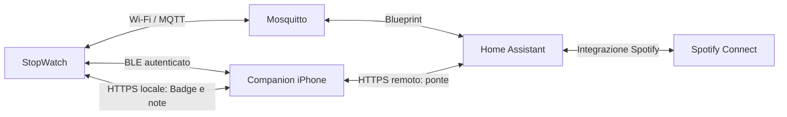

# Architettura

## Componenti

| Percorso | Responsabilità |
|---|---|
| `src/main.cpp` | Avvio, schermate, touch, pulsanti, notifiche, luminosità e frequenza CPU |
| `include/controls.h`, `include/ui_layout.h` | Eventi dei pulsanti, gesti e aree interattive |
| `src/settings.*` | Validazione e persistenza della configurazione |
| `src/voice_notes.*` | Registrazione PCM, archivio e riascolto |
| `src/badge.*`, `include/badge_format.h` | Formato SWB1, upload atomico, fotogrammi e orientamento |
| `src/clock_view.*`, `include/clock_model.h` | Quadranti, timer e cronometro |
| `src/companion.*`, `include/ble_protocol.h` | BLE autenticato, richieste JSON ed eventi |
| `src/note_transfer.*` | Trasferimenti HTTPS locali con ticket monouso |
| `src/home_assistant.*`, `src/mqtt_bridge.*` | Richieste Casa, discovery MQTT e comandi Spotify |
| `src/music_artwork.*` | Download e cache della copertina corrente |
| `src/portal.*` | Configurazione tramite browser Wi-Fi temporaneo |
| `ios/StopWatch/` | App SwiftUI, CoreBluetooth, archivio locale, trascrizione e ponte Internet |
| `home_assistant/blueprints/` | Configurazione visuale e automazioni lato Home Assistant |

## Esecuzione e reattività

Arduino ESP32 gira su FreeRTOS. Il loop dell’interfaccia aggiorna input e stato senza aspettare il completamento delle richieste Home Assistant; audio, HTTPS e parte del lavoro di rete usano task o callback separati. Code e controlli delle richieste impediscono risposte vecchie e doppie azioni. Non sostituire la verifica di un comando con un secondo toggle automatico: una richiesta riuscita la cui risposta viene persa non deve essere ripetuta.

La CPU può scendere a 80 MHz a display spento, nell’orologio e nel Badge fermo. Interazioni, movimento, GIF attive, audio e operazioni in corso richiedono 240 MHz. Il disegno periodico dell’orologio usa un breve boost senza rinnovare il periodo di attività. Wi-Fi e BLE restano attivi; questa politica non è deep sleep.

## Trasporti

Con MQTT disponibile, Casa e Spotify usano il broker. Se il broker non è raggiungibile e il ponte è abilitato, il dispositivo inoltra richieste correlate via BLE al Companion. L’iPhone usa l’URL remoto di Home Assistant e restituisce il risultato sullo stesso collegamento. L’esecuzione a telefono bloccato dipende dalle condizioni e dai limiti di background di iOS; deve essere provata sul dispositivo reale.

Per note e Badge, BLE negozia il trasferimento e può comunicare IP, certificato e ticket HTTPS. Il client verifica l’identità del dispositivo; il ticket è monouso e scade. Se il percorso locale fallisce, resta l’alternativa BLE. I tentativi di trasferimento di un file non devono trasformarsi in ripetizioni automatiche di un comando domotico.

## Protocollo e compatibilità

Il protocollo BLE corrente è `1`. I messaggi JSON sono delimitati da newline; le risposte sono correlate all’ID della richiesta. Eventi come `notes.changed` e `relay.request` possono condividere lo stream delle risposte: i client non devono assumere una notifica uguale a un messaggio completo. I limiti sono definiti nei parser e verificati dai test.

`config.get` restituisce la configurazione senza password e token ordinari. `config.set` convalida prima di salvare; per campi opzionali come `clock_keep_awake`, l’omissione da un client precedente conserva il valore corrente. Il Companion rilegge la configurazione prima del salvataggio e applica solo la sezione modificata. L’importazione del token del ponte usa il percorso autenticato dedicato e il portachiavi iOS.

I topic MQTT e le risposte dei blueprint sono documentati in [home_assistant/README.md](../home_assistant/README.md). Gli ID del dispositivo derivano dall’hardware; non inserire ID della propria installazione come costanti del firmware.

## Memoria e dati

`partitions.csv` definisce NVS, dati OTA, due slot applicazione da 4 MiB e un archivio LittleFS da circa 7,94 MiB. La presenza di due slot non implica che sia implementato un aggiornamento OTA dal Companion.

- NVS conserva configurazione e dati gestiti dai servizi del dispositivo, compresi gli abbinamenti Bluetooth.
- LittleFS conserva note WAV, Badge e `/ui-sounds.bin`.
- PSRAM ospita immagini, cache dei fotogrammi, font e buffer audio secondo le necessità dei moduli.
- Il contenitore privato iOS conserva note ricevute, trascrizioni e anteprima Badge; il token del ponte resta nel portachiavi.

Gli upload Badge restano provvisori fino a verifica di dimensioni, contenuto e SHA-256. Le copie delle note non cancellano automaticamente l’originale. Non cambiare partizioni o formattare per liberare spazio nel codice: capacità dell’applicazione e spazio dell’archivio sono distinti.
